# Barcode types

Each symbology has its own method on [Barcodes](api/barcodes.md). The method checks the value
straight away and throws `ArgumentException` with a clear message when it cannot be encoded, so a bad
value fails where you pass it, not when you render. `Barcodes.Create(BarcodeType, value)` does the
same for a type chosen at run time.

| Method | Kind | Standard | Typical use |
| --- | --- | --- | --- |
| [`Code128`](#code-128) | Linear | ISO/IEC 15417 | Shipping, logistics, internal labels |
| [`Gs1Code128`](#gs1-128) | Linear | GS1 General Specifications | GS1 logistics labels (SSCC, GTIN, lot, dates) |
| [`Code39`](#code-39) | Linear | ISO/IEC 16388 | Automotive, defence, older industrial systems |
| [`Ean13`](#ean-13) | Linear | ISO/IEC 15420 | Retail products worldwide, books (ISBN) |
| [`Ean8`](#ean-8) | Linear | ISO/IEC 15420 | Small retail packages |
| [`UpcA`](#upc-a) | Linear | ISO/IEC 15420 | Retail products in North America |
| [`QrCode`](#qr-code) | 2D | ISO/IEC 18004 | URLs, Wi-Fi, payments, tickets |
| [`DataMatrix`](#data-matrix) | 2D | ISO/IEC 16022 | Small parts marking, healthcare, electronics |
| [`Itf`](#interleaved-2-of-5) | Linear | ISO/IEC 16390 | Warehousing, distribution, numeric IDs |
| [`Itf14`](#itf-14) | Linear | GS1 General Specifications | Outer cartons and cases (GTIN-14) |
| [`Codabar`](#codabar) | Linear | ANSI/AIM BC3 | Libraries, blood banks, courier forms |
| [`Pdf417`](#pdf417) | Stacked 2D | ISO/IEC 15438 | ID cards, boarding passes, shipping documents |
| [`Aztec`](#aztec) | 2D | ISO/IEC 24778 | Transport tickets, boarding passes |
| [`MaxiCode`](#maxicode) | 2D | ISO/IEC 16023 | Parcel sorting |

## Code 128

```csharp
Barcodes.Code128("TerraFluent-2026").HumanReadableText().ToSvg();
```

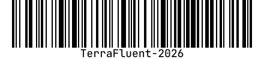

- **Input:** ASCII 0-127, up to 256 characters (`Barcodes.MaxCode128Length`).
- Code sets A, B and C are chosen automatically for the shortest symbol. Runs of digits are packed
  two per symbol in code set C:

```csharp
Barcodes.Code128("00123456789012").HumanReadableText();
```

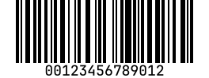

## GS1-128

```csharp
Barcodes.Gs1Code128("(01)09501101530003(17)250101(10)ABC123").HumanReadableText();
```

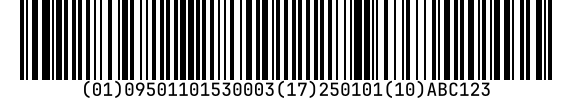

- **Input:** a GS1 element string, each application identifier (AI) in parentheses.
- FNC1 is inserted at the start and after every variable-length field that is not last.
- Every AI must be one GS1 defines, and its data is checked for length, digits, check digit and
  dates. Up to 48 data characters.
- When the data itself contains parentheses, pass the elements as tuples instead:

```csharp
Barcodes.Gs1Code128(("01", "09501101530003"), ("10", "LOT(A)"));
```

## Code 39

```csharp
Barcodes.Code39("TERRAFLUENT").WithChecksum().HumanReadableText();
```

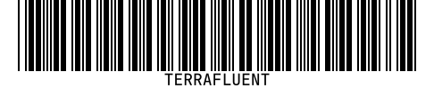

- **Input:** `0-9`, `A-Z`, space and `- . $ / + %`, up to 128 characters (`Barcodes.MaxCode39Length`).
- `WithChecksum()` appends the optional modulo 43 check character.
- `FullAscii()` encodes all 128 ASCII characters, including lower case, as two-character sequences.
  The scanner must have Full ASCII mode turned on to read it back:

```csharp
Barcodes.Code39("Mixed Case").FullAscii().HumanReadableText();
```

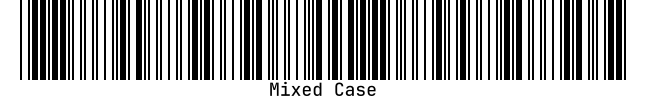

## EAN-13

```csharp
Barcodes.Ean13("590123412345").HumanReadableText();
```

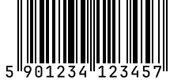

- **Input:** 12 digits (the check digit is added) or 13 digits (the check digit is validated).
- `AddOn("52")` or `AddOn("52495")` adds an EAN-2 or EAN-5 supplement, used for periodicals and book
  prices:

```csharp
Barcodes.Ean13("978123456789").AddOn("52495").HumanReadableText();
```

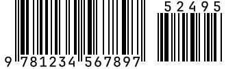

## EAN-8

```csharp
Barcodes.Ean8("9638507").HumanReadableText();
```

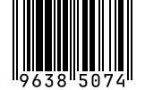

- **Input:** 7 digits (the check digit is added) or 8 digits (the check digit is validated).

## UPC-A

```csharp
Barcodes.UpcA("03600029145").HumanReadableText();
```

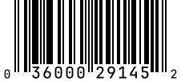

- **Input:** 11 digits (the check digit is added) or 12 digits (the check digit is validated).
- Takes an EAN-2 or EAN-5 add-on with `AddOn(...)`, like EAN-13.

## QR code

```csharp
Barcodes.QrCode("https://terrafluent.dev/barcode/");
```

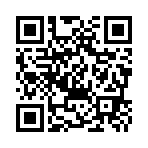

- **Input:** any text. It is split into numeric, alphanumeric and byte segments to give the smallest
  code. Versions 1 to 40 are chosen automatically.
- Non-ASCII text is encoded as UTF-8 with an ECI header, so scanners decode it correctly:

```csharp
Barcodes.QrCode("Grüße — こんにちは");
```

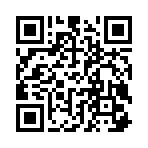

- `ErrorCorrection(level)` picks how much of the code can be damaged and still read: `L` (about 7%),
  `M` (15%, the default), `Q` (25%) or `H` (30%). Higher levels make larger codes:

```csharp
Barcodes.QrCode("WIFI:T:WPA;S:Guest;P:welcome123;;").ErrorCorrection(QrErrorCorrectionLevel.H);
```

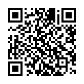

QR codes can also be styled with rounded modules, shaped eyes, gradients and a logo; see
[Styling](styling.md).

## Data Matrix

```csharp
Barcodes.DataMatrix("TerraFluent.Barcode Data Matrix");
```

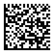

- **Input:** any text, UTF-8 via ECI when needed. ECC 200, in all 30 square and rectangular sizes.
- `DataMatrixShape(...)` chooses `Square` (the default), `Rectangle` or `Any` (the smallest of either):

```csharp
Barcodes.DataMatrix("TF-2026").DataMatrixShape(DataMatrixShape.Rectangle);
```

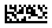

## Interleaved 2 of 5

```csharp
Barcodes.Itf("12345678").HumanReadableText();
```

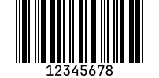

- **Input:** digits only, up to 80 (`Barcodes.MaxItfLength`). Digits are encoded in pairs, so the
  count must be even, or odd with `WithChecksum()`, which adds a modulo 10 check digit.

## ITF-14

```csharp
Barcodes.Itf14("1540014128876").HumanReadableText();
```

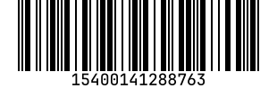

- **Input:** 13 digits (the check digit is added) or 14 digits (the check digit is validated).
- Bearer bars are not drawn.

## Codabar

```csharp
Barcodes.Codabar("A40156B").HumanReadableText();
```

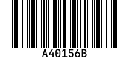

- **Input:** digits and `- $ : / . +`, up to 60 characters (`Barcodes.MaxCodabarLength`), including
  the start and stop characters.
- Start and stop characters are `A`, `B`, `C` or `D` (or `T`, `N`, `*`, `E`). When the value has
  none, `A` is used at both ends.

## PDF417

```csharp
Barcodes.Pdf417("TerraFluent.Barcode PDF417 sample");
```

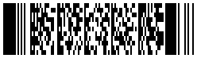

- **Input:** any text, UTF-8 via ECI when needed. Text, numeric and byte compaction are chosen
  automatically.
- `Pdf417Columns(1-30)` sets the number of data columns, and `Pdf417ErrorCorrection(0-8)` the error
  correction level. Both are chosen automatically when not set:

```csharp
Barcodes.Pdf417("TerraFluent.Barcode PDF417 sample").Pdf417Columns(3).Pdf417ErrorCorrection(4);
```

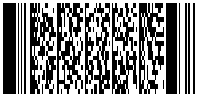

## Aztec

```csharp
Barcodes.Aztec("TerraFluent.Barcode Aztec sample");
```

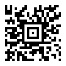

- **Input:** any text; non-ASCII text is sent as UTF-8 with an ECI. Upper, lower, mixed,
  punctuation, digit and byte modes are chosen automatically for the shortest symbol.
- The smallest compact (1-4 layers) or full-range (up to 32 layers) symbol that fits is used.
- `AztecErrorCorrection(5-90)` sets the share of the symbol used for error correction, plus 3 check
  words. The default is 23%:

```csharp
Barcodes.Aztec("TerraFluent.Barcode Aztec sample").AztecErrorCorrection(50);
```

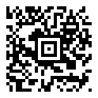

## MaxiCode

```csharp
Barcodes.MaxiCode("152382802", 840, 1, "TerraFluent.Barcode MaxiCode");
```

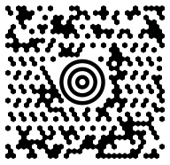

- A fixed-size symbol of 33 rows of hexagons around a bullseye, about 1 inch square at the default
  module size of 6 px.
- `MaxiCode(postalCode, countryCode, serviceClass, message)` writes a structured carrier message:
  mode 2 for a numeric postal code of up to 9 digits, mode 3 for an alphanumeric one of up to 6
  characters. The country (ISO 3166 numeric) and service class are numbers from 0 to 999.
- `MaxiCode(value)` uses mode 4 for Latin-1 text of up to 93 characters (138 digits).
  `MaxiCodeMode(5)` uses enhanced error correction (up to 77 characters) and `MaxiCodeMode(6)` marks
  a reader programming symbol:

```csharp
Barcodes.MaxiCode("TerraFluent.Barcode").MaxiCodeMode(5);
```

## Not yet supported

QR Kanji mode, structured append, and Data Matrix C40, Text and EDIFACT compaction (Data Matrix
uses ASCII encodation, which still packs digit pairs). ITF-14 bearer bars, Aztec runes and
structured append, and MaxiCode ECI and structured append. Planned work is listed in the
[Roadmap](roadmap.md).
