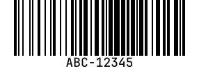

# Getting started

## Install

```shell
dotnet add package TerraFluent.Barcode
```

Or add the package reference to your project file:

```xml
<PackageReference Include="TerraFluent.Barcode" Version="1.3.0" />
```

## Your first barcode

```csharp
using TerraFluent.Barcode;

Barcodes.Code128("ABC-12345").HumanReadableText().Save("label.png");
```



`Save` picks the format from the file extension (`.png`, `.jpg`/`.jpeg` or `.svg`).

## Your first QR code

```csharp
string svg = Barcodes.QrCode("https://terrafluent.dev/barcode/")
    .ModuleSize(6)
    .ToSvg();
```


## Show a barcode in a web page

A data URI drops straight into an `img` element, with no file or endpoint:

```csharp
string src = Barcodes.Ean13("590123412345").ToDataUri(BarcodeImageFormat.Svg);
// 
```

## Return a barcode from ASP.NET Core

```csharp
app.MapGet("/barcode/{sku}", (string sku) =>
    Results.File(Barcodes.Code128(sku).ToPng(), "image/png"));
```

`WriteToAsync` streams straight into the response body when you would rather not buffer:

```csharp
app.MapGet("/qr", async (HttpResponse response, string text) =>
{
    response.ContentType = "image/svg+xml";
    await Barcodes.QrCode(text).WriteToAsync(response.Body, BarcodeImageFormat.Svg);
});
```

For a ready-made barcode endpoint with caching and limits, result helpers and a Razor tag helper,
add the `TerraFluent.Barcode.AspNetCore` package: see [ASP.NET Core](aspnetcore.md).

## Next steps

- [Barcode types](barcode-types.md) for the rules of each symbology.
- [Options](options.md) for size, quiet zone, colours and text.
- [Styling](styling.md) for rounded modules, gradients and logos.
- [Dependency injection](dependency-injection.md) to inject `IBarcodeGenerator` into your services.
- [ASP.NET Core](aspnetcore.md) for the endpoint, result helpers and tag helper.
