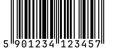

# Introduction

TerraFluent.Barcode turns a value into a barcode image with one fluent chain:

```csharp
byte[] png = Barcodes.Ean13("590123412345").HumanReadableText().ToPng();
```



Each call has three parts:

1. **Pick a symbology.** A static method on [Barcodes](api/barcodes.md) such as `Code128`,
   `QrCode` or `Pdf417` validates the value and returns a [BarcodeBuilder](api/barcodebuilder.md).
2. **Set options.** Size, colours, human-readable text, error correction and styles. Every option
   has a sensible default, so this part is optional.
3. **Choose an output.** `ToPng()`, `ToSvg()`, `ToBase64()`, `Save(path)` and the others in
   [Output formats](output-formats.md).

The value is encoded once, the first time you ask for an output, and reused for every later output
from the same builder, so producing a PNG and an SVG of the same code costs one encode.

## Supported platforms

| Target | Runs on |
| --- | --- |
| `netstandard2.0` | .NET Framework 4.6.1 and later, .NET Core 2.0 and later, Mono, Xamarin, Unity |
| `net10.0` | .NET 10 and later, with trimming and Native AOT |

The library has no package dependencies and no native code. The assembly is strong-named, and its
`AssemblyVersion` stays at `major.0.0.0`, so upgrading within a major version needs no binding
redirects.

## Where to next

- [Getting started](getting-started.md) installs the package and renders your first codes.
- [Barcode types](barcode-types.md) shows every symbology with its rules and an example.
- [API reference](api/index.md) lists every public type and member.
