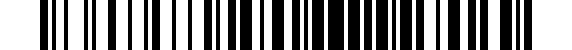
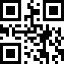
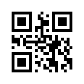
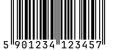

# Options

Options are set with fluent methods on [BarcodeBuilder](api/barcodebuilder.md). Every one has a
default that follows the symbology's standard, so set only what you need.

| Option | Default | Applies to | Notes |
| --- | --- | --- | --- |
| `ModuleSize(px)` | 2 (linear, PDF417), 4 (QR, Data Matrix, Aztec), 6 (MaxiCode) | all | Width of the narrowest bar, one 2D square, or one MaxiCode hexagon. |
| `Height(px)` | 80 | linear | Bar height, not counting the text line. |
| `QuietZone(modules)` | per standard | all | Blank margin, in modules. |
| `Foreground(color)` | black | all | `BarcodeColor`, `"#RRGGBB"` or `"#RGB"`. |
| `Background(color)` | white | all | As above. |
| `TransparentBackground()` | off | all | PNG and SVG only. |
| `HumanReadableText()` | off | linear | The value printed under the bars. |
| `TextSize(px)` | 10 modules (EAN/UPC), 9 modules (others) | linear | Long text shrinks to fit. |
| `ErrorCorrection(level)` | `M` | QR | `L`, `M`, `Q` or `H`. |
| `WithChecksum()` | off | Code 39, Interleaved 2 of 5 | Modulo 43 (Code 39) or modulo 10 (ITF) check character. |
| `FullAscii()` | off | Code 39 | All 128 ASCII characters. |
| `AddOn(digits)` | none | EAN-13, UPC-A | 2 or 5 digits. |
| `DataMatrixShape(shape)` | `Square` | Data Matrix | `Square`, `Rectangle` or `Any`. |
| `AztecErrorCorrection(percent)` | 23 | Aztec | 5-90% of the symbol, plus 3 check words. |
| `MaxiCodeMode(mode)` | 4 | MaxiCode | 4 (standard), 5 (enhanced error correction) or 6 (reader programming). |
| `Pdf417Columns(n)` | automatic | PDF417 | 1 to 30. |
| `Pdf417ErrorCorrection(n)` | automatic | PDF417 | 0 to 8. |
| `JpegQuality(1-100)` | 90 | JPEG output | |
| `AllowLowContrast()` | off | all | Skips the contrast check. |
| `ImageSizeLimit(pixels)` | 64 megapixels | all | Lowers the maximum image area. |

Setting an option that does not apply to the symbology, such as `Height` on a QR code, throws
`InvalidOperationException`, so mistakes show up early. (`BarcodeOptions`, used with
[dependency injection](dependency-injection.md), ignores such options instead, so one set of
defaults serves every type.)

Styling options (module and eye shapes, gradients, logos and rounded bars) are covered in
[Styling](styling.md).

## Module size and height

The module size is the scale of the whole code. Scanners read best when it is a whole number of
device pixels, which is why it is an integer.

```csharp
Barcodes.Code128("ABC-12345").ModuleSize(2).Height(50);
Barcodes.Code128("ABC-12345").ModuleSize(4).Height(50);
```




## Quiet zone

The quiet zone is the blank margin a scanner needs to find the code. The defaults follow each
standard: 10 modules for Code 128 and Code 39, 11 for EAN-13, 9 for UPC-A, 7 for EAN-8, 4 for QR
codes and 2 for Data Matrix and PDF417.

```csharp
Barcodes.QrCode("TF").ModuleSize(6).QuietZone(0); // no margin
Barcodes.QrCode("TF").ModuleSize(6);              // 4 modules, the standard
```

| `QuietZone(0)` | Default |
| --- | --- |
|  |  |

Only remove the quiet zone when the surrounding layout provides the margin.

## Colours

```csharp
Barcodes.QrCode("https://terrafluent.dev/barcode/").Foreground("#1A3C8F").Background("#FFF8E0");
Barcodes.Code128("ABC").Foreground(new BarcodeColor(0x1A, 0x3C, 0x8F)).Background(BarcodeColor.White);
```

Foreground, gradient and eye colours need a WCAG contrast ratio of at least 3:1 against the
background (`BarcodeBuilder.MinContrastRatio`), or rendering throws `InvalidOperationException`.
Light-on-dark codes are allowed. `BarcodeColor.ContrastRatio(a, b)` lets you check a pair yourself,
and `AllowLowContrast()` turns the check off for colour pairs you have tested with your scanners.

See [Styling](styling.md#colours-and-transparency) for examples.

## Human-readable text

```csharp
Barcodes.Ean13("590123412345").HumanReadableText();
Barcodes.Code128("TerraFluent-2026").HumanReadableText().TextSize(14);
```



EAN and UPC codes print their digits in the standard positions, with the extended guard bars.
Code 128, Code 39 and GS1-128 centre the value under the bars (GS1-128 shows the AIs in
parentheses). The text is drawn from embedded JetBrains Mono glyph outlines, so it looks the same
on every platform and needs no installed fonts.
