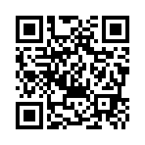

# Output formats

Every builder can produce every format. Pick the one that fits where the barcode is going.

| PNG | JPEG | SVG |
| --- | --- | --- |
|  |  |  |
| Lossless, small, everywhere | Lossy; softens edges | Vector; scales to any size |

```csharp
var qr = Barcodes.QrCode("https://terrafluent.dev/barcode/").ModuleSize(5);

byte[] png  = qr.ToPng();
byte[] jpeg = qr.ToJpeg();
string svg  = qr.ToSvg();
```

The code is encoded once and reused, so asking the same builder for several formats is cheap.

## Choosing a format

- **PNG** is the best default. Plain barcodes are written as 1-bit indexed PNGs, the smallest
  lossless form; styled codes (gradients, rounded modules, logos) are anti-aliased 8-bit colour.
- **SVG** is ideal for web pages, print and PDFs: it is resolution-independent, and gradients and
  curves are real vector shapes.
- **JPEG** is there for systems that only accept it. Barcodes are two-colour images, and JPEG
  compression blurs bar edges, so prefer PNG or SVG. Set the quality with `JpegQuality(1-100)`
  (default 90). JPEG cannot be transparent.

`BarcodeImageFormat` names the three formats, and has helpers for MIME types and file extensions:

```csharp
BarcodeImageFormat.Svg.ToMimeType();        // "image/svg+xml"
BarcodeImageFormat.Jpeg.ToFileExtension();  // ".jpg"
BarcodeImageFormatExtensions.FromFilePath("label.png"); // BarcodeImageFormat.Png
```

## Output methods

| Method | Returns |
| --- | --- |
| `ToPng()` | `byte[]` PNG |
| `ToJpeg()` | `byte[]` baseline JPEG |
| `ToSvg()` | `string` SVG document |
| `ToBytes(format)` | `byte[]` in any format |
| `ToStream(format)` | read-only `MemoryStream` at position 0 |
| `WriteTo(stream, format)` | writes into your stream |
| `WriteToAsync(stream, format, ct)` | writes into your stream asynchronously |
| `ToBase64(format)` | base64 `string` |
| `ToDataUri(format)` | `data:image/...;base64,...` string |
| `Save(path)` / `Save(path, format)` | writes a file |
| `SaveAsync(path, ct)` / `SaveAsync(path, format, ct)` | writes a file asynchronously |
| `GetImageSize()` | `(Width, Height)` of the output in pixels |
| `Encode()` | the raw [BarcodeMatrix](api/barcodematrix.md); see [Custom rendering](custom-rendering.md) |

Methods that take a `format` default to PNG.

### Byte arrays

```csharp
byte[] png = Barcodes.Code128("ABC-12345").ToPng();
byte[] svgBytes = Barcodes.Code128("ABC-12345").ToBytes(BarcodeImageFormat.Svg); // UTF-8
```

### Strings: SVG, base64 and data URIs

```csharp
string svg = Barcodes.DataMatrix("TF-2026").ToSvg();
string base64 = Barcodes.Ean13("590123412345").ToBase64();
string dataUri = Barcodes.UpcA("03600029145").ToDataUri(BarcodeImageFormat.Png);
```

Base64 is handy for JSON APIs; data URIs go straight into ``, CSS or e-mail HTML.

### Streams

```csharp
// A new stream holding the image
using Stream stream = Barcodes.QrCode("hello").ToStream(BarcodeImageFormat.Png);

// Or write into a stream you own: a file, an HTTP response, a ZIP entry
using var file = File.Create("hello.svg");
Barcodes.QrCode("hello").WriteTo(file, BarcodeImageFormat.Svg);

await Barcodes.Code128("X1").WriteToAsync(response.Body, BarcodeImageFormat.Png, cancellationToken);
```

`WriteTo` encodes straight into your stream without a full intermediate buffer.

### Files

```csharp
Barcodes.Ean8("9638507").Save("ean8.svg");                        // format from the extension
Barcodes.Ean8("9638507").Save("ean8.img", BarcodeImageFormat.Png); // explicit format
await Barcodes.Ean8("9638507").SaveAsync("ean8.png", cancellationToken);
```

`Save(path)` recognises `.png`, `.jpg`, `.jpeg` and `.svg`, and throws `ArgumentException` for any
other extension.

### Asynchronous output

`WriteToAsync` and `SaveAsync` encode on the calling thread, because encoding is CPU-bound and takes
well under a millisecond for most codes, and then write asynchronously. The cancellation token is
also checked while encoding.

### Image size

`GetImageSize()` returns the size the output will have, without rendering it, which helps with
layout:

```csharp
var (width, height) = Barcodes.Code128("ABC-12345").HumanReadableText().GetImageSize();
```
