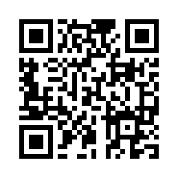
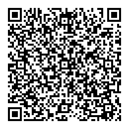
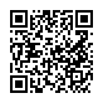

# QR payloads

A phone camera does more with a QR code than show its text when the text follows a known format: it
offers to join a Wi-Fi network, save a contact, open a link, start an email, text or call a number.
Those formats have escaping rules that are easy to get wrong (a `;` in a Wi-Fi password, a comma in
a company name, a space in an email subject). `QrPayload` builds the text for you, validates it, and
returns a plain `string` that you pass to `Barcodes.QrCode` like any other value:

```csharp
using TerraFluent.Barcode;

byte[] png = Barcodes.QrCode(QrPayload.Wifi("Guest", "welcome123")).ToPng();
```

Because a payload is just a string, the rest of the fluent chain works as usual (error correction,
styling, any output format), and the same payload works in `Barcodes.DataMatrix` or `Barcodes.Aztec`
too. Every helper throws `ArgumentException` for input the format cannot express, so a bad label is
caught before it is printed.

## Wi-Fi

```csharp
string wifi = QrPayload.Wifi("Guest", "welcome123");
// WIFI:T:WPA;S:Guest;P:welcome123;;

QrPayload.Wifi("Office;5G", "p@ss;word", WifiSecurity.Wpa, hidden: true);
// WIFI:T:WPA;S:Office\;5G;P:p@ss\;word;H:true;;

QrPayload.Wifi("Lobby", null, WifiSecurity.None);
// WIFI:T:nopass;S:Lobby;;
```



`WifiSecurity.Wpa` covers WPA, WPA2 and WPA3 Personal. Backslash, semicolon, comma, colon and
double quote are escaped in the network name and password. The name is at most 32 bytes as UTF-8; a
WPA password is 8 to 63 characters or 64 hex digits, and a WEP key is 5 or 13 characters or 10 or
26 hex digits.

## Contact (vCard)

```csharp
string vcard = QrPayload.Contact(new ContactCard
{
    FirstName = "Ada",
    LastName = "Lovelace",
    Organization = "Analytical Engines Ltd",
    MobilePhone = "+44 7700 900123",
    Email = "ada@example.com",
    Website = "https://example.com",
});
```



The result is a vCard 3.0 (RFC 2426), which iOS and Android both save as a contact. A card needs a
first name, last name or organization; every other property (`JobTitle`, `Phone`, `MobilePhone`,
`WorkPhone`, `Email`, `Website`, `Street`, `City`, `Region`, `PostalCode`, `Country`, `Birthday`,
`Note`) is optional and left out when empty. Backslash, comma, semicolon and line breaks are escaped,
phone numbers are normalized as for `QrPayload.Phone`, and the email and website are validated.

A contact holds a lot of text, so its QR code is dense. Set only the fields you need, and give it a
larger printed size or a smaller error-correction level if it is hard to scan.

## Link

```csharp
QrPayload.Url("https://terrafluent.dev/barcode/");   // unchanged
QrPayload.Url("terrafluent.dev/barcode");            // https://terrafluent.dev/barcode
```

A value without a scheme gets `https://` in front. Only `http` and `https` addresses are accepted, so a
`javascript:` or other unexpected link cannot slip into a printed code.

## Email

```csharp
QrPayload.Email("hello@example.com", subject: "Order 1042", body: "Hi,\nI have a question.");
// mailto:hello@example.com?subject=Order%201042&body=Hi%2C%0D%0AI%20have%20a%20question.
```

The result is a `mailto:` link (RFC 6068). The subject and body are percent-encoded as UTF-8, and line
breaks in the body become CRLF. The address must be a single address.

## Phone call and text message

```csharp
QrPayload.Phone("+1 (555) 123-4567");                // tel:+15551234567
QrPayload.Sms("+1 555 123 4567", "Running late");    // SMSTO:+15551234567:Running late
```

Spaces, dashes, dots and parentheses are removed, and a leading `+` is kept. Letters (such as
`1-800-FLOWERS`) are rejected, because phones do not translate them.

## GS1 Digital Link

A [GS1 Digital Link](https://www.gs1.org/standards/gs1-digital-link) is a web address that carries
GS1 identifiers, such as a product's GTIN, batch and expiry date. Point-of-sale scanners read the
identifiers and phones open the web page, so one QR code on a pack does both jobs.

```csharp
QrPayload.Gs1DigitalLink("(01)09501101530003(10)ABC123(17)271231");
// https://id.gs1.org/01/09501101530003/10/ABC123?17=271231

QrPayload.Gs1DigitalLink(new Uri("https://brand.example.com"),
    ("01", "09501101530003"), ("21", "SN-42"), ("10", "ABC123"));
// https://brand.example.com/01/09501101530003/10/ABC123/21/SN-42
```



Give the elements as an element string with AIs in parentheses (as for `Barcodes.Gs1Code128`) or as
AI and data pairs. Without a domain, GS1's own resolver `https://id.gs1.org` is used; pass your own
domain to send scans to your site.

- Exactly one element must be a primary key: GTIN (01), SSCC (00), GLN (414), GRAI (8003), GIAI
  (8004), GSRN (8017, 8018), GDTI (253), GCN (255), GINC (401), GSIN (402), ITIP (8006), CPID (8010)
  or GMN (8013).
- The key's qualifiers go in the path, in the order the standard sets, whatever order you give them:
  CPV (22), batch (10) and serial (21) for a GTIN; GLN extension (254) for a GLN; and so on. Every
  other AI becomes a query parameter, in the order given.
- A GTIN of 8, 12 or 13 digits is padded with zeros to 14, as the standard requires.
- Each AI's data is checked as for GS1-128 (length, character set, check digit, dates), and
  characters outside the URI unreserved set are percent-encoded.

This builds the uncompressed form of a Digital Link. The compressed form is not supported.
