# Styling

Rounded and dotted modules, shaped eyes, gradients, logos and rounded bars work in every output
format. SVG output gets real gradients and curves; PNG and JPEG output is anti-aliased. A barcode
without any style produces exactly the same output as before styles existed.

Every style keeps each module's centre where a scanner samples it, and a logo is kept clear of the
eyes, timing and format modules. Still, test-scan styled codes on the devices you target.

## Colours and transparency

```csharp
Barcodes.QrCode("https://terrafluent.dev/barcode/").Foreground("#1A3C8F").Background("#FFF8E0");
Barcodes.QrCode("https://terrafluent.dev/barcode/").TransparentBackground();
```

| Custom colours | Transparent background |
| --- | --- |
| 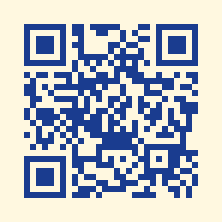 |  |

A transparent background works in PNG and SVG; JPEG output then throws
`InvalidOperationException`. The contrast check still uses `Background`, so set it to the colour of
the surface the code will sit on.

## QR module styles

`ModuleStyle(QrModuleStyle)` shapes the data modules.

```csharp
Barcodes.QrCode(url).ModuleStyle(QrModuleStyle.Rounded);
```

| `Square` (default) | `Rounded` | `Dots` | `Connected` |
| --- | --- | --- | --- |
| 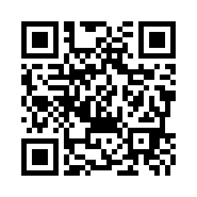 | 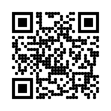 | 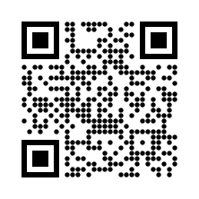 | 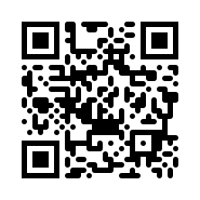 |

## QR eye styles and colour

`EyeStyle(QrEyeStyle)` shapes the three corner finder patterns, and `EyeColor(color)` colours them.

```csharp
Barcodes.QrCode(url).EyeStyle(QrEyeStyle.Circle).EyeColor("#E65100");
```

| `Square` (default) | `Rounded` | `Circle` |
| --- | --- | --- |
| 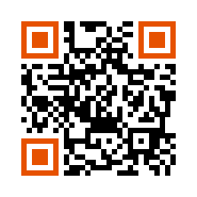 |  | 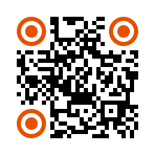 |

## Gradients

`Gradient(start, end, direction)` fills the dark modules or bars with a gradient. It works on every
symbology.

```csharp
Barcodes.QrCode(url).Gradient("#0D47A1", "#7B1FA2", GradientDirection.Horizontal);
```

| `Horizontal` | `Vertical` | `Diagonal` (default) | `Radial` |
| --- | --- | --- | --- |
| 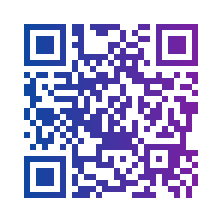 | 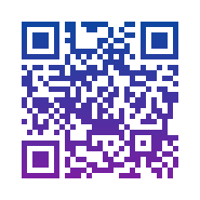 | 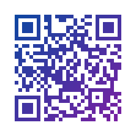 |  |

Both gradient colours must pass the contrast check against the background, so keep them dark on a
light background.

## Logos

`Logo(png, scale)` places a PNG (transparency is kept) in the centre of a QR code and clears the
modules behind it.

```csharp
string svg = Barcodes.QrCode("https://terrafluent.dev/barcode/")
    .ModuleSize(8)
    .ModuleStyle(QrModuleStyle.Connected)
    .EyeStyle(QrEyeStyle.Rounded)
    .EyeColor("#E65100")
    .Logo(File.ReadAllBytes("logo.png"), scale: 0.25)
    .ToSvg();
```


- `scale` is the logo's width as a fraction of the code's width, from 0.05 to 0.3 (default 0.2). It
  is shrunk if needed so the eyes and format modules stay visible.
- Unless you set `ErrorCorrection` yourself, the code switches to level H so it still scans with the
  covered modules missing. Level Q is accepted up to a scale of 0.25; levels L and M throw
  `InvalidOperationException`, because such codes often fail to scan.

## Rounded bars

`RoundedBars()` gives linear barcodes pill-shaped bars, and combines well with a gradient.

```csharp
Barcodes.Code128("ABC-12345").ModuleSize(3).RoundedBars()
    .Gradient("#0D47A1", "#7B1FA2", GradientDirection.Horizontal);

Barcodes.Ean13("590123412345").ModuleSize(3).RoundedBars()
    .Gradient("#B71C1C", "#E65100", GradientDirection.Vertical)
    .HumanReadableText();
```


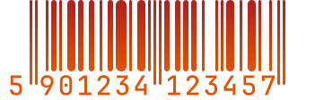

## Style reference

| Option | Applies to | Values |
| --- | --- | --- |
| `ModuleStyle(style)` | QR | `Square` (default), `Rounded`, `Dots`, `Connected` |
| `EyeStyle(style)` | QR | `Square` (default), `Rounded`, `Circle` |
| `EyeColor(color)` | QR | colour of the three corner eyes |
| `Logo(png, scale)` | QR | PNG bytes; `scale` 0.05 to 0.3 (default 0.2) |
| `Gradient(start, end, direction)` | all | `Horizontal`, `Vertical`, `Diagonal` (default), `Radial` |
| `RoundedBars()` | linear | rounded bar ends |
